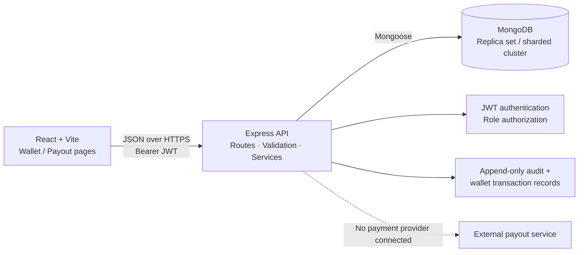
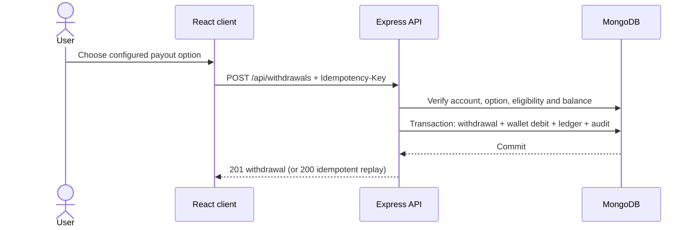

# VELoop Rewards Wallet

<p align="center">
  <strong>A full-stack demonstration wallet with a React client, an Express API, and a MongoDB-backed transaction ledger.</strong>
</p>

<p align="center">
  <a href="./API_DOCUMENTATION.md">API reference</a> ·
  <a href="#get-started">Get started</a> ·
  <a href="#testing">Testing</a> ·
  <a href="#deployment">Deployment</a>
</p>

> [!IMPORTANT]
> **Demonstration project only.** This application is not affiliated with or
> connected to VELoop production systems. It does not send money or integrate
> with a payment provider. Seeded payout amounts are assignment references,
> not verified live offers. Use only a database and credentials you control;
> never enter real payout details.

## At a glance

| Area | Technologies and capabilities |
|---|---|
| Client | React 18, Vite, React Router |
| API | Node.js, Express 4, Mongoose |
| Database | MongoDB replica set or sharded cluster |
| Authentication | bcrypt password hashing, signed JWT bearer tokens |
| Wallet | VES, SVES, gems, tokens, and spins; append-only transaction history |
| Withdrawals | Database-configured options, idempotent requests, privileged review |
| Operations | Health/readiness endpoints, rate limits, audit records, Render/Vercel configs |

Public registration creates a standard `USER` account with an empty wallet.
Wallet credits/debits and withdrawal review are restricted to `ADMIN` and
`INTERNAL` accounts provisioned by trusted operators. There is no reviewer UI.

## Architecture



### Request and money-movement flow



Review approval changes the request status only; it does not transfer funds.

## Repository map

| Path | Responsibility |
|---|---|
| `frontend/src/pages/` | Signup, login, wallet, and payout screens |
| `frontend/src/services/api.js` | Browser-side API client and bearer-token handling |
| `backend/src/routes/` | HTTP endpoint definitions |
| `backend/src/controllers/` | Request handling and response serialization |
| `backend/src/services/` | Wallet, payout configuration, and withdrawal rules |
| `backend/src/models/` | MongoDB schemas for users, wallets, ledger, payouts, withdrawals, and audits |
| `backend/tests/` | Unit, HTTP, and opt-in MongoDB integration tests |
| `backend/postman/` | Local API request collection |
| `backend/seed/` | Explicitly guarded demo and payout-reference seed scripts |

## Get started

### Prerequisites

- Node.js 20+ and npm
- MongoDB Atlas or a local MongoDB replica set

MongoDB transactions are required for registration, wallet mutations, and
withdrawal operations. A standalone MongoDB server is not sufficient. For a
local replica set, include its replica-set name in the connection string (for
example, `?replicaSet=rs0`) and ensure that the local MongoDB instance is
configured as that replica set.

### 1. Configure and run the API

From the repository root in PowerShell:

```powershell
Set-Location .\backend
npm ci
Copy-Item .env.example .env
```

Edit `backend\.env` and set `MONGO_URI` to your own replica-set database. Replace
the example `JWT_SECRET` with a unique random value of at least 32 characters.
You can generate one with:

```powershell
node -e "console.log(require('crypto').randomBytes(48).toString('base64url'))"
```

Start the API:

```powershell
npm run dev
```

### 2. Configure and run the client

Open a second PowerShell terminal at the repository root:

```powershell
Set-Location .\frontend
npm ci
Copy-Item .env.example .env
npm run dev
```

Open the local URL printed by Vite (normally `http://localhost:5173`). The
client defaults to `http://localhost:5000/api`.

### Environment reference

| Variable | Component | Default / requirement |
|---|---|---|
| `PORT` | API | `5000`; integer from 1 to 65535 |
| `MONGO_URI` | API | Required; use a replica-set or sharded MongoDB connection |
| `JWT_SECRET` | API | Required; unique secret of at least 32 characters |
| `JWT_EXPIRES_IN` | API | `1h` |
| `FRONTEND_ORIGIN` | API | `http://localhost:5173`; exact allowed browser origin |
| `TRUST_PROXY_HOPS` | API | `0`; set to the number of trusted proxies in front of the API |
| `VITE_API_BASE_URL` | Client | `http://localhost:5000/api`; public build-time URL, not a secret |
| `SEED_DEMO_DATA` | API seed | `false`; explicitly set to `true` to run the demo seed |
| `DEMO_USER_PASSWORD` | API seed | Required private 8–72-byte password when demo seeding |
| `SEED_PAYOUT_REFERENCE_VALUES` | API seed | `false`; explicitly set to `true` to load reference payout data |
| `PAYOUT_REFERENCE_DATABASE` | API seed | Optional exact database-name guard for reference data |

Keep `.env` files, `MONGO_URI`, and `JWT_SECRET` private. Never put database
credentials or signing secrets into frontend environment variables.

## What’s included

- Account signup, login, and current-user lookup.
- User-scoped wallet balances and paginated transaction history.
- Privileged wallet credit/debit operations with an append-only ledger and audit
  entry committed atomically with the balance change.
- Payout methods and options loaded from MongoDB, rather than hardcoded in the
  client.
- Withdrawal submission with server-validated amounts, request idempotency,
  wallet debit, and review state history.
- Privileged processing, approval, and rejection. Rejection restores the
  original wallet amount in a new reversal ledger entry.
- Liveness (`/api/health`) and database-readiness (`/api/ready`) probes.

See the [API documentation](./API_DOCUMENTATION.md) for endpoint contracts,
request examples, access requirements, and error responses.

## Testing

Run the backend unit and HTTP tests:

```powershell
Set-Location .\backend
npm test
```

Build the frontend for production:

```powershell
Set-Location .\frontend
npm run build
```

MongoDB integration tests are opt-in. The scripts and required environment
variables are listed below; each URI must target a dedicated, disposable
replica-set test database. These suites may create or modify test records. Do
not use production data.

| Script | Required URI variable |
|---|---|
| `npm run test:auth:integration` | `AUTH_TEST_MONGO_URI` |
| `npm run test:payout:integration` | `PAYOUT_TEST_MONGO_URI` |
| `npm run test:wallet:integration` | `WALLET_TEST_MONGO_URI` |
| `npm run test:withdrawal:integration` | `WITHDRAWAL_TEST_MONGO_URI` |

The payout integration test requires a disposable database name ending in
`test`.

## Demo and reference data

Both seeds are opt-in. The demo seed creates `demo@veloop.test` with sample
balances and history; the reference seed configures assignment-reference UPI
options and leaves unsupported payout methods unavailable. Read the guards in
[`backend/seed/`](./backend/seed/) before running either command. Never run
seeds against production or enter real personal payout information.

Seeded users/options are created only in the database pointed to when the seed
runs; deploying the app does not copy local data. Review and wallet mutation
routes require an `ADMIN` or `INTERNAL` account created through trusted
administration. Public signup cannot grant those roles. A withdrawal approval
only records a status change; it does not execute a transfer.

## Deployment

The repository includes a Render Blueprint in [`render.yaml`](./render.yaml)
and Vercel client-side routing in
[`frontend/vercel.json`](./frontend/vercel.json). Deployment is optional and
requires accounts and infrastructure you control.

1. Create a dedicated MongoDB Atlas replica-set database and configure its
   network access for your hosting environment.
2. Deploy the API using the Render Blueprint. Set `MONGO_URI` and
   `FRONTEND_ORIGIN`; Render generates `JWT_SECRET`. Match `FRONTEND_ORIGIN`
   exactly to the deployed client origin and configure `TRUST_PROXY_HOPS` for
   the trusted proxy chain.
3. Deploy `frontend/` to Vercel with `npm ci`, `npm run build`, and `dist` as
   the output directory. Set `VITE_API_BASE_URL` to
   `https://<your-render-service>.onrender.com/api`.
4. Verify the API readiness probe at
   `https://<your-render-service>.onrender.com/api/ready`, then test signup,
   login, wallet loading, and configured payout options.

Do not seed demo or assignment-reference data in production. The API's
rate-limit counters use process memory; they reset on restart and are not
shared between instances. Use one API instance unless you add a shared
rate-limit store.

## Rate limits

| Route group | Limit per client IP |
|---|---:|
| `/api/auth/*` | 10 requests / 15 minutes |
| `POST /api/withdrawals` | 5 requests / 15 minutes |
| Withdrawal review actions | 30 requests / 15 minutes |

The built-in store is in-memory; Redis or an Upstash API key is not required
for a single instance. Behind a proxy, set `TRUST_PROXY_HOPS` to the actual
trusted proxy count. Do not trust arbitrary forwarded headers.

## Design note

Scale based on measured transaction volume and latency, not registered-user
count alone. Preserve atomic conditional balance updates, MongoDB transactions,
idempotency constraints, and ledger reconciliation. Profile database queries
and indexes before considering sharding. A production payout integration
would additionally need a transactional outbox, retryable idempotent workers,
reconciliation, and operational monitoring.
